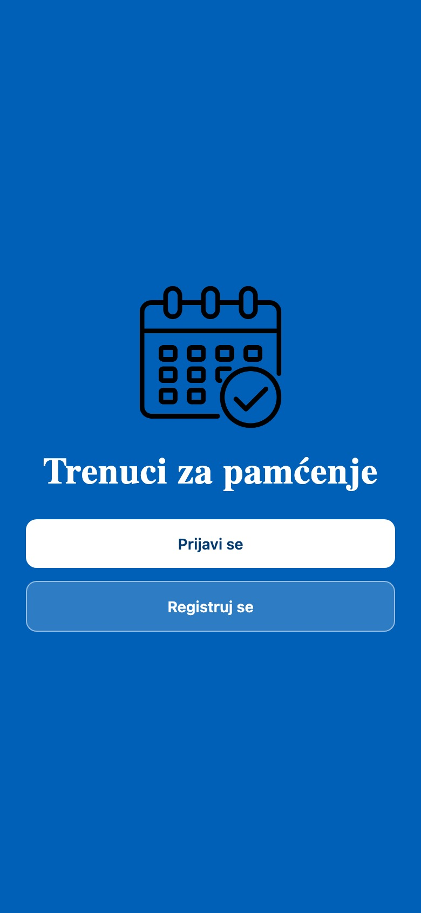
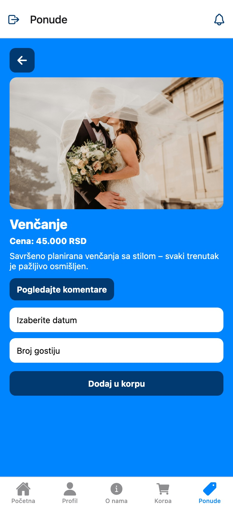
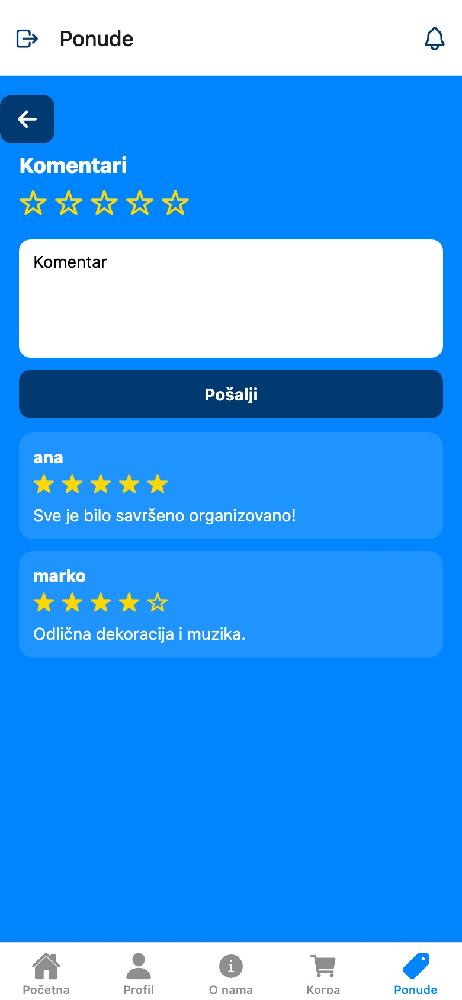
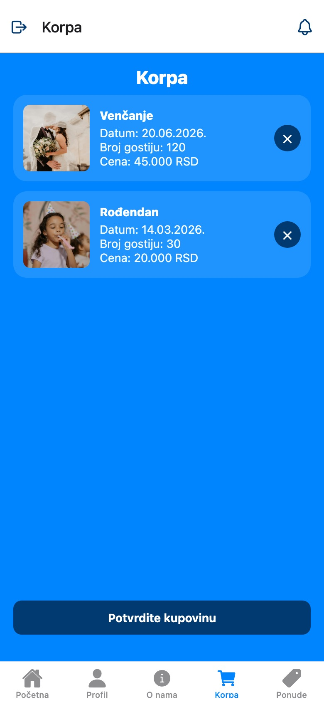
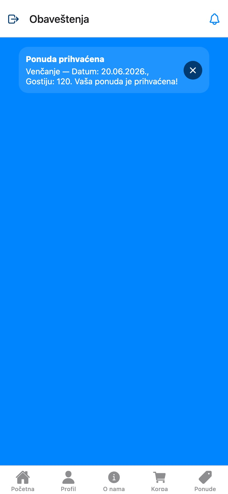
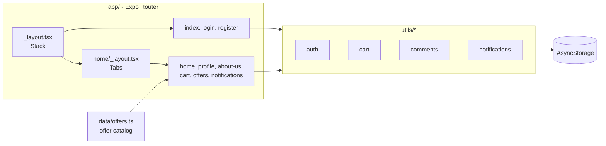

# Moments to Remember (mobile)

[](https://github.com/djokerg/moments-to-remember-mobile/actions/workflows/ci.yml)

A mobile app for an event-planning agency: customers browse packages (weddings, birthdays,
graduations…), book a date, keep a cart and leave star ratings. Built with React Native,
Expo and Expo Router, in TypeScript.

The UI is in Serbian (the app is called *Trenuci za pamćenje*). This is the mobile version of the
[web app](https://github.com/djokerg/moments-to-remember-web), which has a
[live demo](https://djokerg.github.io/moments-to-remember-web/).

<p>
  
  
  
  
</p>
<p>
  
  
  
  
</p>

## Run it

Requires Node.js 20.19+ and either an iOS Simulator (Xcode) or an Android emulator (Android Studio).

```bash
npm ci
npx expo start
```

Then press `i` for the iOS Simulator or `a` for the Android emulator. Expo CLI installs a
matching version of Expo Go in the simulator automatically.

The project uses **Expo SDK 54**. The Expo Go app in the App Store and Play Store only supports the
newest SDK, so scanning the QR code with a physical phone may not work without
[upgrading the SDK](https://docs.expo.dev/workflow/upgrading-expo-sdk-walkthrough/).

## Features

- Welcome, registration and login screens; the session survives app restarts
- Home screen with a swipeable carousel and a list of services
- Offer list and offer detail with a native date picker and guest count
- Cart with item removal and checkout
- Star ratings and comments per offer
- Notifications screen, reachable from the bell icon in the header
- Profile editing and password change (minimum 6 characters)
- Bottom tab navigation with logout in the header

## Architecture

There is no backend. Screens read and write a few small storage modules backed by
[AsyncStorage](https://react-native-async-storage.github.io/async-storage/), the persistent
key-value store on the device.



## How it works

- **File-based routing.** Every file under [`app/`](app) is a screen. The root
  [`_layout.tsx`](app/_layout.tsx) is a stack with the welcome, login and register screens, and
  [`home/_layout.tsx`](app/home/_layout.tsx) puts the logged-in screens in bottom tabs. Offers
  use a nested dynamic route, [`home/offers/[id]/`](app/home/offers/%5Bid%5D), with its own
  comments screen.
- **Session handling.** [`utils/auth.ts`](utils/auth.ts) stores the registered user and the current
  session under separate keys. The welcome and login screens check for a session on mount and
  `<Redirect>` straight to `/home` if one exists; the logout button clears it.
- **Native-only date picker.** The offer detail screen loads
  `@react-native-community/datetimepicker` only when `Platform.OS` is iOS or Android, and shows it
  inline on iOS and as a dialog on Android.
- **Booking flow.** Checkout in [`home/cart.tsx`](app/home/cart.tsx) writes a "booking accepted"
  notification for every cart item and empties the cart. There is no organizer side in the mobile
  app, so acceptance is immediate.
- **Comments per offer.** [`utils/comments.ts`](utils/comments.ts) keeps one AsyncStorage key per
  offer (`comments_v1_<offerId>`), so loading an offer's comments reads only that list.

## Project layout

```
app/                 screens (Expo Router)
  home/              tab screens shown after login
    offers/[id]/     offer detail and comments
    profile/         profile and password change
data/offers.ts       offer catalog
utils/               AsyncStorage-backed stores
theme.ts             colors
assets/              images and icons
docs/screenshots/    README images
```

## Limitations

- No server: data is stored on the device only.
- One account per device; registering again replaces the stored user.
- Passwords are stored in plain text in AsyncStorage. Fine for a demo, never for real users.
- Bookings are accepted automatically at checkout.
- Screenshots were taken from Expo's web build in a phone-sized browser window.
- UI text is Serbian only.

## Credits

Built by Djordje Grebovic in 2025 as a project for the *User Application Programming* course at
the University of Belgrade. All code, design and content are the author's own.
